<p align="center">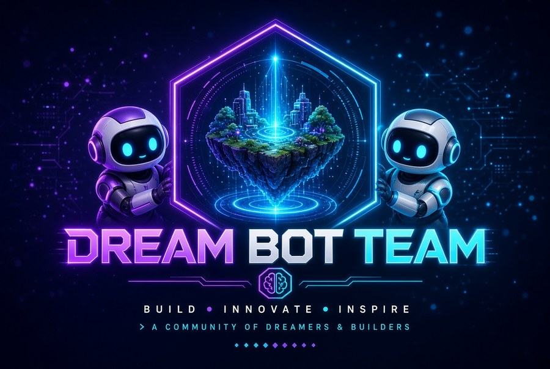</p>

# UEFN Dream Bot Team: AI agents and MCP tools for Fortnite maps

[](LICENSE) [](https://github.com/mimmo-the-root/UEFN-dream-bot-team/releases) [](https://github.com/mimmo-the-root/UEFN-dream-bot-team/actions/workflows/tests.yml) [](https://github.com/mimmo-the-root/UEFN-dream-bot-team/stargazers)
    [](https://mimmo-the-root.github.io/UEFN-dream-bot-team/sitemap.xml) [](https://github.com/mimmo-the-root/UEFN-dream-bot-team/releases)
    


**Dream Bot Team** is a free, open-source Claude Code kit for building, testing and improving
**UEFN** (Unreal Editor for Fortnite) maps with AI. It gives you twenty-two specialized AI agents (seventeen team agents plus five UEFN MCP sub-agents),
each with one narrow job, instead of one general-purpose assistant trying to do everything and
stepping on its own toes. It writes and fixes **Verse** code in a plan-first loop, and it drives the
**UEFN MCP** (Epic's Model Context Protocol server for the editor) with recipes that were proven on a
live editor.

- **AI agents** with a plan-first workflow: no task counts as done until two independent reviewers sign off.
- **Skills** for Verse, level devices, UI widgets, Niagara VFX, materials, physics, performance and map growth (titles, thumbnails, trailers, launch plans).
- **Every UEFN MCP tool mapped, recipes proven on a live editor**: arguments, prerequisites, cleanup and known traps for each tool.
- **Learns from your maps** and keeps your data on your computer; sharing lessons is optional and private by default.
- **Agent Console**: a local dashboard that shows each agent working, MCP activity and token use.
- **MIT license**, works for one island or fifty.

Built by someone juggling ~50 UEFN islands at once.

**[Read the manual](https://mimmo-the-root.github.io/UEFN-dream-bot-team/)**: quick start, the team, the console, the UEFN MCP tool reference, troubleshooting.

## Screenshots

**The Agent Console header** — session stats, token usage, and the "miniflow" rail tracking a
task live through its five gated stages (intent-gate → coder → intent-reviewer →
compliance-reviewer → planner-docs):

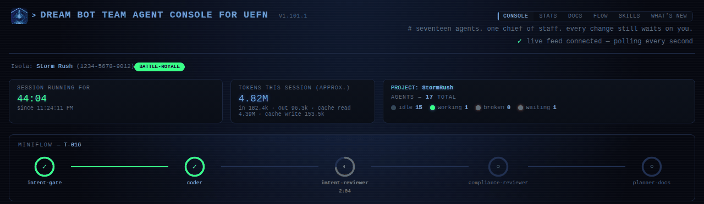

**The full Agent Console** — the header above, plus every agent's live status at a glance (demo data):

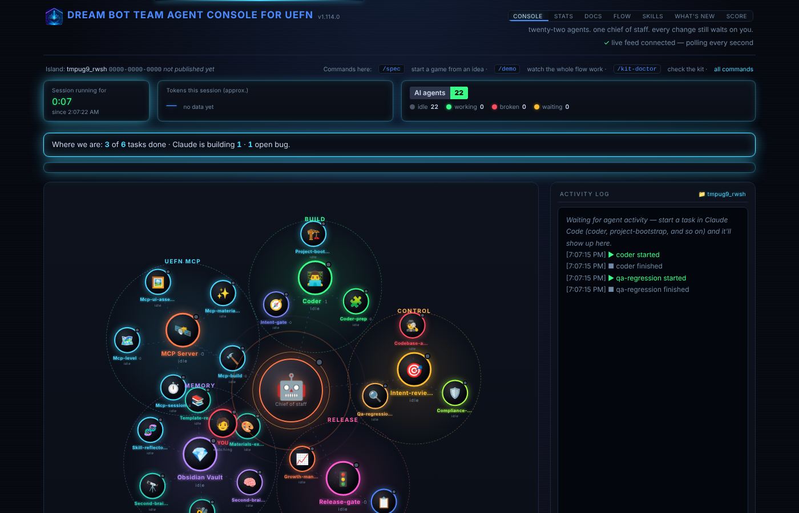

**The Skills page** — what waits for you and what the kit has learned: four cards (waiting, lessons,
recipes, projects), a LEARN button for the map or Fab product you are in, and tabs: To approve, To share,
Lessons, Recipes, Skills, Maps & products, This map / This product, UEFN MCP and Community. Sample data:

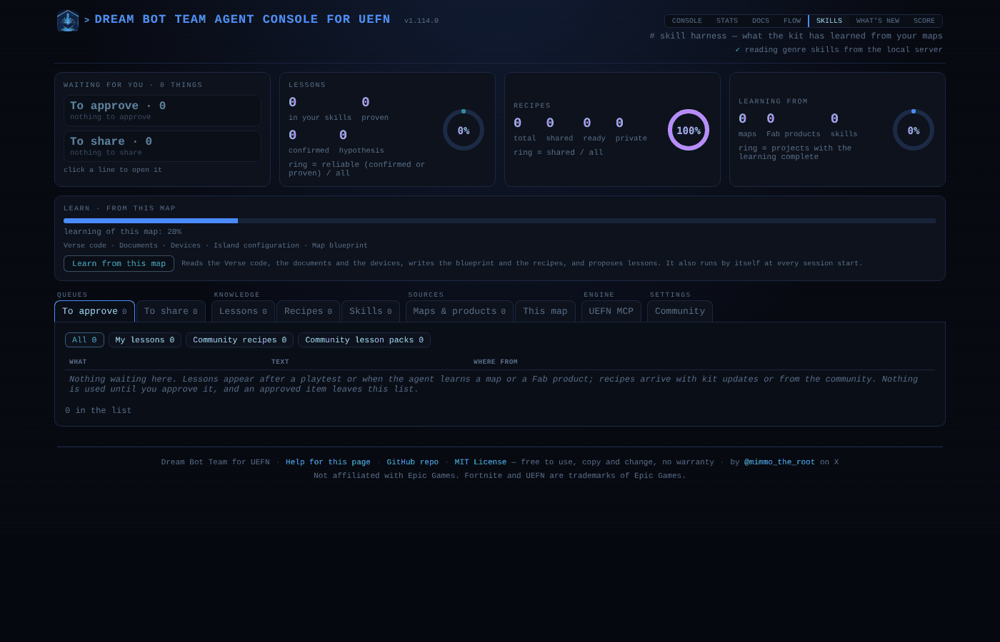

**The Docs page** — header, the three progress rings, the next action with a Copy command button, and tabs: **Idea**, **Spec**, **Plan**, **Roadmap**, **Bugs**, **Status**, **Documents**. A dot on each of the first three says where the game is: grey not started, amber now, green done. Everything is read from the project's own files (demo data):

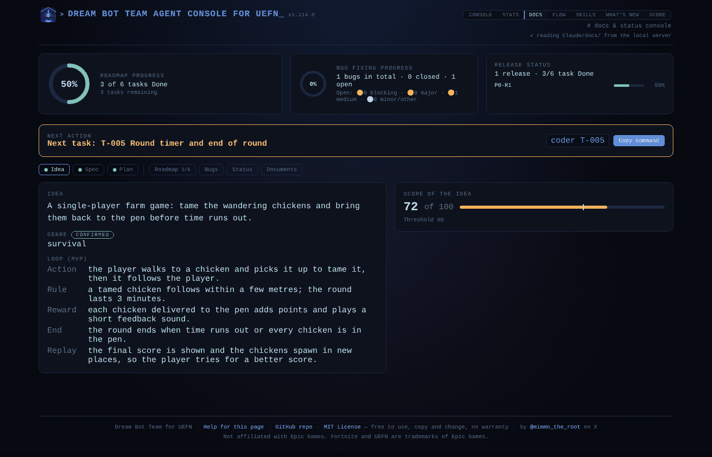

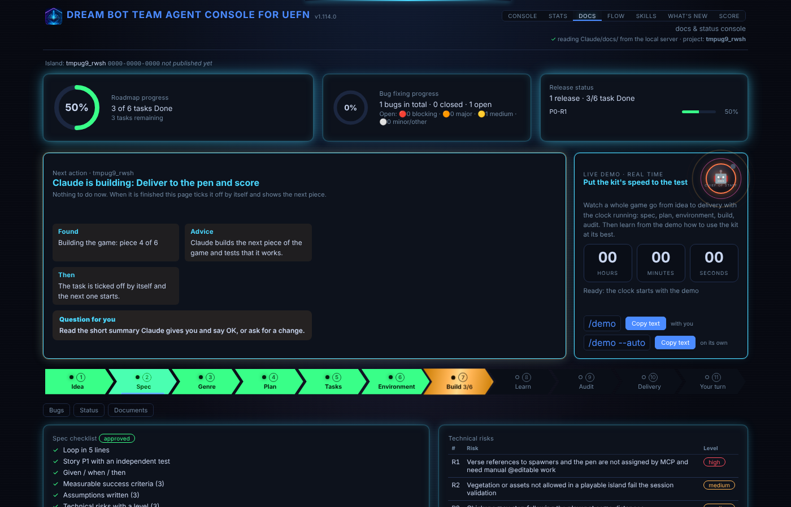

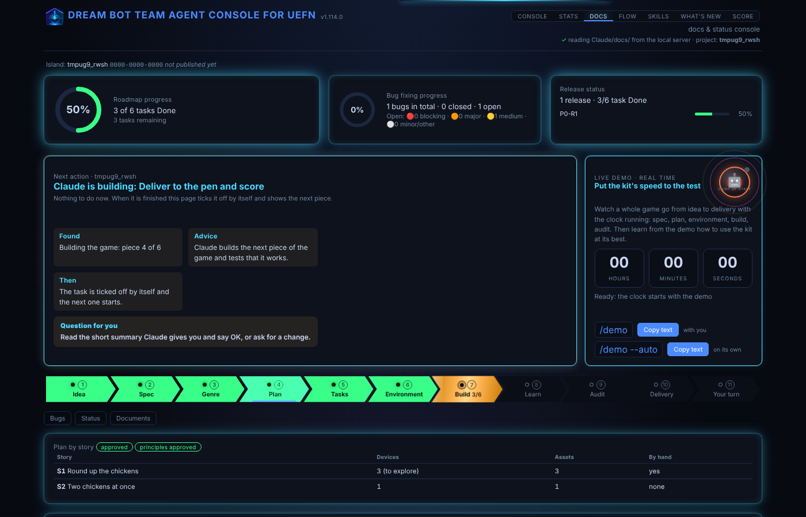

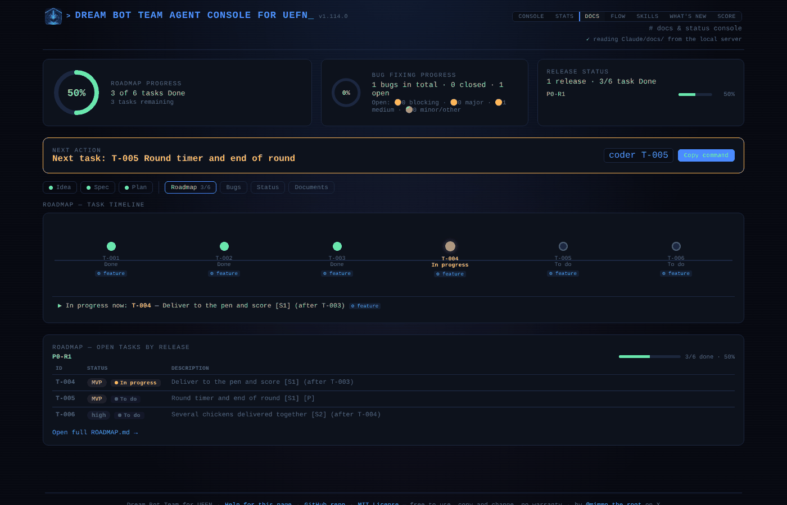

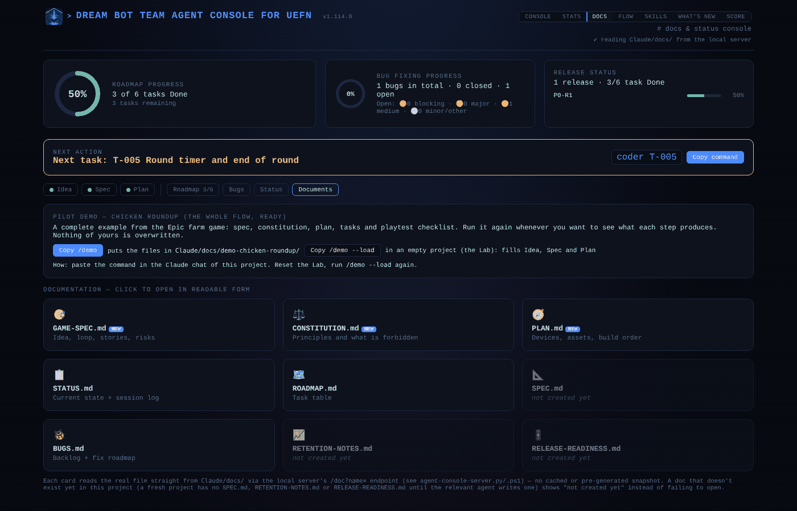

### From an idea to a playable game

| Step | You type | Claude writes | You decide |
|---|---|---|---|
| Idea, genre, spec | `/spec "your idea"` | `GAME-SPEC.md` (loop in 5 lines, stories, success criteria, risks, sources consulted) | the genre, one approval |
| Principles and plan | `/game-plan` | `CONSTITUTION.md`, `PLAN.md` | one approval |
| Tasks | `/task-list` | the Tasks table in `ROADMAP.md` | nothing |
| Check | `/consistency` | a read-only report | what to fix first |
| Environment and playtest | `/environment`, `/environment --playtest` | the readout (with the Island settings to set), `PLAYTEST.md` | the steps only you can do |
| Audit | `/audit` | `AUDIT.md`: small bugs fixed by itself, the serious ones listed | what to do with each serious one |
| Delivery | `/delivery` | `DELIVERY-GATE.md` | tick each box yourself, write the memory %, make the private release |

`/spec` and `/game-plan` study first: second brain, genre lessons, retention and feasibility skills, proven recipes. Small bugs are fixed by themselves only if they are on the constitution's list (Self-healing). The full walk-through is the manual chapter *From an idea to a playable game*.

### Try the pilot demo

The kit ships Chicken Roundup (from the Epic farm example): spec, constitution, plan, six tasks and a playtest checklist, all passing the kit's checks. **Do not use your real map**: make a new empty UEFN project for tests, open Claude Code in its `Content` folder, run `/kit-update`, then `/demo` (the flow with you) or `/demo --auto` (no questions, the AI approves every step), timed by a stopwatch on the Docs page (total on top, running phase below). Only these two buttons; the demo loads its files by itself and moves an earlier demo to `_to_delete`. The What's new page lists what waits in `_to_delete` with buttons to open the folder and to clean it. To run it again, use a fresh test project.

**The Flow page** — the pipeline as a U-shaped board: one card and one agent icon per station, tokens per agent, Control Tower and Pipeline pulse (demo data):

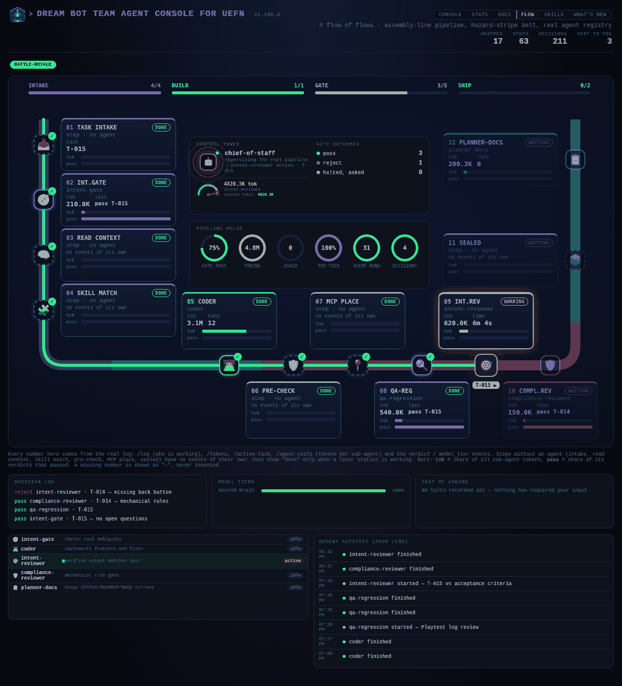

**The full pipeline** — every agent and every hand-off, end to end:

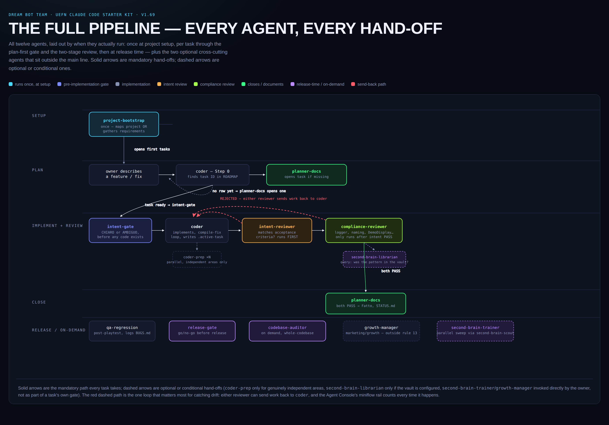

## What's new (v1.102 - v1.114.0)

- **Study, environment and playtest (1.114).** `/spec` and `/game-plan` start from the second brain, the genre lessons and the proven recipes and write their sources; `/environment` reads the environment from the plan without changing anything and lists what only you can do; `/environment --playtest` writes a checklist from the spec. `/spec` asks how many players from the start (multiplayer needs the Island settings in the plan), `/audit` fixes small bugs by itself and gives you the serious ones, `/delivery` is the last gate: configuration you must do, private release, memory flag, playtest. The Docs page gets Idea, Spec and Plan tabs.
- **From the spec to the tasks (1.113).** `/game-plan` writes the principles (`CONSTITUTION.md`) and the plan (`PLAN.md`: devices, assets that exist, steps only you can do, two build passes); `/task-list` makes tasks with a test, a story, dependencies and parallel marks; `/consistency` checks spec, plan and tasks read-only, and a conflict with the principles is always CRITICAL.
- **Start a game from the spec (1.112).** `/spec` takes an idea (yours or three proposed), asks the minimum, lets you confirm the genre, scores three variants, writes the loop in five lines and a `GAME-SPEC.md` with measurable criteria, assumptions and a table of technical risks, and asks for one approval. `spec_check.py` is its test list; `--gate` is the door to planning (score 60 or more, or your forced yes) and `--jam` checks the theme line.
- **One workflow for everything you can share (1.111).** Lessons, recipes, skills and the UEFN MCP proof share the same states (collected, ready, shared, private) and the same buttons in every tab, with Promote all / Keep all private. Contribute to the community is on by default (nothing leaves without your click), GitHub opens with the file name, title and description filled in, lessons reach the kit at each release by themselves, and the maintainer has a Maintainer / Contributor view switch.
- **Skills page by tabs, LEARN, recipes (1.110).** One page for maps and Fab products: queues (To approve, To share), knowledge (Lessons, Recipes, Skills), sources (Maps & products, This map / product), UEFN MCP and Community. A LEARN button for maps and for Fab products, recipes prepared by the kit from your Verse code and shared both ways through the community, a folder called FAB is a Fab product by itself, and the assets are cleaned of user and project names before `check` and `zip`.
- **Fab Checklist (1.110).** A console page for Fab products: six stations with every check in plain language, a verdict with bar and percentage, tickable items for what only you can judge, a recorded UEFN validation, and a scan of the assets for traces of other projects (the cause of two rejections). Nothing is written in the project.
- **Safe editing (1.109).** `/editor-changes` and an undo plan for what the agents wrote to the editor, one writer at a time (a real lock), recipes flagged for replay when UEFN changes a tool, a static Verse check, and a console proof with screenshots.
- **Fab products, economy, log signals (1.109).** The `fab-product` skill and the `fab_pack.py` helper check a Fab package against Epic's rules, create `Documentation/` and `FabListing/` texts from your Verse code, make a panoramic image grid and write a clean zip; nothing is installed in the product. `economy-sim` plans a tycoon economy with numbers, `[SIGNAL]` log lines let `qa-regression` check what happened in a playtest, and `delivery.py` writes a delivery document for a map.
- **The kit updates itself (1.108.3).** A background check of the newest GitHub release runs at session start, at most every 6 hours, and downloads a newer one into your profile; the project follows at its next session. **If you have an older version, do this once:** run `/kit-update --fetch` in a session (or `update-my-profile.cmd` from the repo), then open a new session. Older kits cannot update themselves because nothing in them looks at GitHub. Off switch: an empty file `~/.claude/kit-auto-update.off`.
- **Score page (1.108.1).** A new console tab that measures the project against its own plan, release by release: a chart of plan, built and proven with a forecast, and a green, yellow or red light per criterion so you see where to act first. It reads ROADMAP, BUGS and the readiness verdict by itself; new criteria are proposed on the Skills page and need your approval.
- **Ready for the jam (1.108).** A new project asks whether it is a map or a Fab product (a map gets the kit, a Fab product never does). Verse headers keep only the present and every change goes to a log. `/concept-card` scores an idea, `/devlog` writes the dev log from the logs, `/jam-check` checks the entry before you hand it in.
- **The MCP, mapped, learned and proven (1.107).** The Console is now a small solar system: five planets around the chief of staff, the other agents as moons, token arcs, a detail card, pinned agents and switches to show or hide each part. 14 UEFN MCP skills and 5 MCP sub-agents ship in the kit; recipes are marked `tool-ok` or `proven`, and what you prove can be shared with the community (counts only). UEFN can be restarted after a crash if you opt in; a running editor is never closed.
- **Flow page as a U-shaped board (1.106).** Twelve stations along a U, one card and one agent icon per station, zone progress bars, the Control Tower and a Pipeline pulse. Tokens, time and verdicts come from the real log and `/agent-costs`; a missing number is shown as a dash, never invented.
- **Tokens per agent (1.104).** A table at the bottom of the Console, counted from the sub-agent transcripts: runs, calls, input, output and cache, per agent. Counts, not prices.
- **The kit maps UEFN's MCP by itself (1.106).** All 388 tools in 30 toolsets are catalogued at session start (no AI tokens), safe tools are test-called, and the Skills page shows how much of the MCP the kit really uses. New chapter in the manual: "The MCP engine". An optional laboratory mode (`mcp_lab.py`, with its own safety checks) lets agents try every tool in a disposable project.
- **Verse UI Kit skill (1.106).** `verse-ui-kit` teaches in-game screens with or without Epic's free kit; `/ui-kit-check` tells whether it is installed and whether Epic changed it. Epic's guide is never copied into this repo.
- **Verse build check (1.102 - 1.103).** `/verse-check` asks the open UEFN to compile and reports clean, errors or not analysed; build errors are logged and recurring ones become lesson proposals. `/text-scan` finds emoji and invisible characters in publication text.
- **Fewer questions, easier handovers (1.105).** Pre-approved read-only commands and `/handoff` for long sessions.
- **Files are parked, not lost (1.106).** If a delete is refused, the file goes to `_to_delete` and you are told; the Docs page now follows the files by itself.

Full list: [CHANGELOG.md](CHANGELOG.md).

## What's new (v1.100 - v1.101)

- **A manual you can read in the browser:** 13 chapters (quick start, full installation, the team, the console
  page by page, skills and lessons, community, troubleshooting, FAQ, glossary) with screenshots. Online at
  [mimmo-the-root.github.io/UEFN-dream-bot-team](https://mimmo-the-root.github.io/UEFN-dream-bot-team/), and built
  into the kit at `http://127.0.0.1:8765/manual/`.
- **A "Help for this page" link and a footer on every console page** (repo, MIT license, author), and the project logo.

## What's new (v1.99)

- **Share your lessons with the community (voluntary).** A switch on the Skills page and a **Contribute**
  button on each approved lesson: you see the exact JSON, then GitHub opens a pull request from your own
  account. Only lessons, only from a **published** map; map names, code and blueprints never leave.
  A curator agent proposes what to promote and the maintainer validates it before a release; creators
  receive the community lessons as proposals to approve. See [docs/community-contributions.md](docs/community-contributions.md).
- **Safe by design.** Fixed format, screening against instructions aimed at an assistant, an isolated
  classifier, a strict plain-English character filter, statements regenerated by the curator, revocation of a lesson from everyone's skills.
- **New page: What's new.** The last release, new and improved skills, top contributors, thanks and a
  "Submit an issue" link.

## What's new (v1.98)

- **The kit learns from your maps by itself.** At the first session on a map it reads the Verse
  code, compares your project documents with the code (and corrects the ones that are wrong), reads
  the devices placed in the level, their wiring and settings, and the island configuration through
  the UEFN MCP. It never interviews you, and if the session stops it resumes where it stopped.
- **Map blueprint.** What it learned becomes a *blueprint* inside the genre skill: how a map of
  this kind is built (layout with counts, game loop, devices and how they are wired, rules with the
  numbers observed, build order). It follows your development: when code, documents or devices
  change, the blueprint is marked out of date and rewritten at the next session. Items it could not
  read are retried at the next starts (never invented), and every analysed map also queues 3 to 5
  general lessons for your approval.
- **You confirm genre and map type before anything is saved.** The genre is one of Epic's official
  Discover genres; the map *type* is a free name (pillars, red-vs-blue, checkpoint-race...). The
  kit only proposes them: you confirm or correct both on the Skills page, and until then nothing
  touches your skills. Confirming saves the waiting blueprint and lessons by itself.
- **IP variants.** A map that is the same base game dressed for an IP is a *type* of the same
  genre: the kit reads the IP from your documents, proposes it as the type (the shared base is
  `base`), and the blueprint of the variant records only what differs from the base.
- **Skills page rebuilt**: the kit overview on top (waiting lessons, maps, genres and types,
  confidence, privacy), the genre of this map below, **Approve all** for waiting lessons, and the
  **SKILLS tab blinks** on every console page when something waits for you.
- **Docs & Status page**: releases are listed in delivery order (P0-R1, P1-R1, P1-R2...).
- **The console follows the kit**: after an update the console server restarts on the new version,
  and it stops when you leave the session.
- **Releases are published by GitHub.** `publish.cmd` runs the tests, commits, pushes and tags;
  the workflow in `.github/workflows/release.yml` then creates the GitHub Release from the
  changelog.

Your map data stays private: blueprints and evidence live in a local layer of your own genre skill,
names are hashed, and only generalized patterns can be shared, after a privacy check.

## Earlier: v1.83

- **Skills page — the kit learns from your maps** (`agent-console-skills.html`). Genre skills
  (survival, roguelike, …) used to stay empty until three maps had been studied. Now a genre skill
  starts learning from your first map: after a playtest the `skill-reflector` agent queues lessons,
  and **you approve, edit or reject each one** on the Skills page. Every pattern carries a
  confidence level from your own maps (hypothesis → confirmed → proven), and a map that contradicts
  a pattern marks it **contested** instead of overwriting it.
- **Your map data stays on your computer.** Map names, task IDs and notes live in a private
  `local/` layer that is never exported or committed. Only generalized patterns (`pack/`) can be
  shared, and only after a privacy check. Incoming community packs are merged by pattern ID into a
  proposal you review; your own evidence always wins.
- **Everything is English and looks the same**: all seven consoles (Console, Stats, Docs, Flow,
  Skills, What's new, Score) share one header, theme and menu, and show an update notice when a newer GitHub Release
  exists.
- **Docs & Status console redesigned** around what is still open: roadmap grouped by release with
  progress, open bugs sorted by severity, priorities and owner actions, and a live activity rail.

Design ideas for the Skills mechanics are adapted from
[tigerless-labs/autoharness](https://github.com/tigerless-labs/autoharness) (MIT, see
`THIRD-PARTY-NOTICES.md`).

## What's new (v1.79)

- **Docs & Status console** (`agent-console-docs.html`) — a second dashboard page reading your
  project's real `Claude/docs/*.md` files (ROADMAP.md, BUGS.md, STATUS.md, SPEC.md,
  RETENTION-NOTES.md, RELEASE-READINESS.md) straight off disk, no hardcoded sample data. Shows a
  roadmap-progress ring, a "Recent roadmap tasks" list (code — description, status, priority) and
  a "Recent bug backlog" list (severity, status, description) sorted so what's still open surfaces
  first, plus a click-to-open readable render of every doc.
- **Flow of Flows console** (`agent-console-flow.html`) — the pipeline as a U-shaped board of the same real
  agent activity (start/stop events, token usage per agent, verdicts, active task): one card and one agent
  icon per station, zone progress bars, a Control Tower token gauge that drops back to idle instead of
  sticking to a stale agent, and a Pipeline pulse.
- **Server concurrency fix** (`agent-console-server.ps1` / `.py`) — the local dashboard server no
  longer blocks every open tab for up to 10 seconds when a Fortnite API lookup is slow.
- New shared skills: `game-ui-designer`, `genre` (roguelike/survival pattern evidence), and
  `fortnite-growth-lessons`.

**Docs & Status** — roadmap progress ring, open-bug count, a "Recent roadmap tasks" list and a
"Recent bug backlog" list, both sorted so what's still open surfaces first:

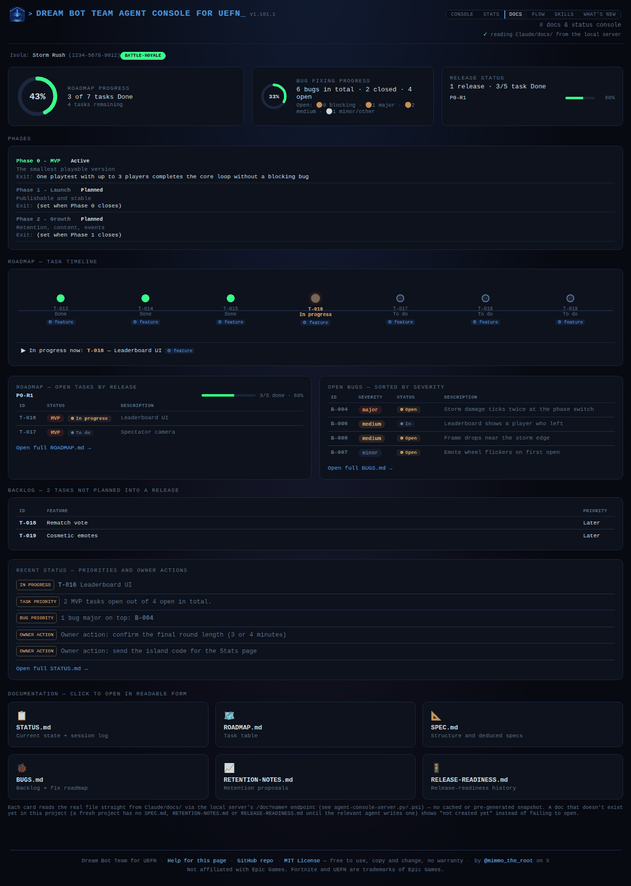

**Flow of Flows** — the same real agent activity as an assembly-line pipeline, with a Control
Tower token gauge and a live decision log:


Full details for every version in [`CHANGELOG.md`](CHANGELOG.md).

## What's in the box

- **Twenty-two agents** (seventeen team agents plus five MCP sub-agents the `coder` orchestrates), each doing one job: project setup, an independent ambiguity check before any
  code is written, the actual Verse coding with a mandatory compile-fix loop, two separate review
  gates (spec adherence, then mechanical rule conformance — never the same agent grading both),
  regression/bug hunting after every playtest, documentation that stays current, a go/no-go release
  check, and an optional second-brain (Obsidian) integration for reusable mechanics.
- **A plan-first workflow**: every code change ties to a tracked task, and a task isn't marked done
  until two independent reviewers have both signed off — no agent grades its own work.
- **A shared cross-project skill** (`uefn-lessons`) that never resets: something learned fixing a
  bug on project #12 stops being invisible on project #37.
- **An optional real-time Agent Console** — a local dashboard showing which agent is working, a
  live "miniflow" rail for the review-gate sequence, MCP server activity, and token usage.
- **`mcp-tool-contracts`**: a single source of truth for which MCP tool to use for which check, so
  the same instruction never quietly diverges across three different agent files.

## Getting started

Read **[the manual](https://mimmo-the-root.github.io/UEFN-dream-bot-team/)** first. It has a
15-minute quick start, the full setup (once per machine, then once per project), who does what in
the team, the console page by page, and troubleshooting. The same manual is built into the kit:
open `http://127.0.0.1:8765/manual/` while the console server runs. Its source is in
[`docs/manual/`](docs/manual). Setup is deliberately manual in a few places rather than a
one-click script, so you see exactly what's being installed.

Full version history is in [`CHANGELOG.md`](CHANGELOG.md).

## Repo layout

```
project-template/       Files copied into each UEFN project's Content/ folder (hooks, docs
                         templates, the Agent Console, per-project CLAUDE.md)
user-level-agents/       The 22 agent definitions, installed once into ~/.claude/agents/
user-level-memory/       Base rules loaded in every session, installed into ~/.claude/CLAUDE.md
user-level-skills/       Shared skills (uefn-lessons, mcp-tool-contracts, and others),
                         installed once into ~/.claude/skills/
second-brain-template/   Optional Obsidian vault template for the second-brain integration
docs/manual/             The manual (Markdown sources, built into the kit and published on GitHub Pages)
SETUP-GUIDE.md           Pointer to the manual
CHANGELOG.md             Version history
```

## Contributing

Issues and pull requests are welcome — see [`CONTRIBUTING.md`](CONTRIBUTING.md). If you
hit a bug in the kit itself (not in your own UEFN project), open an issue with the agent/hook
involved and what you expected vs. what happened. Please follow the
[Code of Conduct](CODE_OF_CONDUCT.md); report security problems privately as described in
[`SECURITY.md`](.github/SECURITY.md).

## License

MIT — see [`LICENSE`](LICENSE). Use it, fork it, ship it in your own team's setup.
